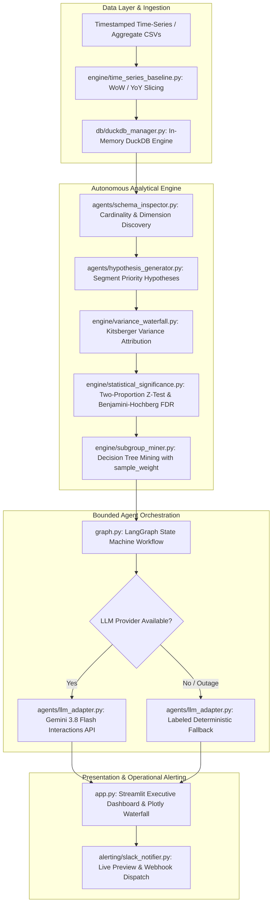

# Autonomous Metric Root Cause Analysis (RCA) & Variance Copilot

[](https://www.python.org/downloads/)
[](tests/)
[](pyproject.toml)
[](pyproject.toml)
[](#core-architecture--separation-of-concerns)
[](LICENSE)

An enterprise-grade, deterministic-first autonomous agentic copilot designed to diagnose metric drops, attribute multi-dimensional variance, and synthesize executive-ready incident narratives. 

Built on a foundational principle: **Strict separation of compute and reasoning.** All statistical variance attribution, SQL execution, and hypothesis tests run through deterministic engines (DuckDB, NumPy, SciPy, Scikit-learn), while LLMs are strictly bounded to executive narrative synthesis and actionable decision support using precomputed evidence.

## Direct database pushdown

`DuckDBManager` can attach SQLite and PostgreSQL databases as read-only DuckDB
catalogs. Attachments are managed through dedicated methods; arbitrary SQL
continues to reject `ATTACH`, `DETACH`, DDL, DML, and multiple statements.

```python
from db.duckdb_manager import DuckDBManager

with DuckDBManager() as manager:
    manager.attach_database("sqlite", "metrics.sqlite")
    print(manager.list_tables())
    aggregates = manager.query_aggregated_metric(
        "remote_db.clicks",
        dimensions=["channel", "device"],
        numerator="conversions",
        denominator="visits",
        where_clause="event_date >= '2026-01-01'",
    )
```

Aggregations execute in DuckDB against the attached host database, returning
only grouped rows rather than loading raw events. SQLite attachments use
`READ_ONLY`; PostgreSQL attachments load DuckDB's PostgreSQL extension and use
the same read-only mode. Connection strings are never included in attachment
errors or state maintained by the manager. PostgreSQL extension installation
may require the runtime's configured DuckDB extension repository.

---

## 🎯 Executive Summary & The Problem

When a core business metric (such as e-commerce checkout conversion rate) drops by **3.4% Week-over-Week**, business leaders need immediate, mathematically grounded answers:
* *Did user propensity drop within specific segments?* (**Rate Effect**)
* *Did traffic mix shift toward historically lower-converting channels, such as paid mobile campaigns?* (**Mix Effect / Simpson's Paradox**)
* *Is the drop statistically significant, or simply random sample noise in low-volume segments?* (**False Discovery Rate**)

Standard "Chat with Data" or LLM-driven analytics bots fail in enterprise environments because:
1. **LLMs cannot do arithmetic reliably**: Hallucinating metric deltas and attribution percentages.
2. **Unguarded Text-to-SQL introduces critical risks**: Unbounded joins, injection attacks, and database load spikes.
3. **Statistical False Positives**: Flagging a segment with 3 visits and 0 conversions as a "primary root cause."

**Autonomous Metric RCA Copilot** solves these challenges by combining in-memory OLAP vectorization, rigorous mathematical variance decomposition, Benjamini-Hochberg FDR control, and bounded agent orchestration.

---

## 🏗️ Core Architecture & Separation of Concerns



---

## ✨ Key Capabilities

### 1. Deterministic Kitsberger Variance Decomposition
Decomposes aggregate conversion rate changes ($\Delta R = R_{\text{current}} - R_{\text{baseline}}$) into three mutually exclusive, mathematically reconciled components across every dimension:
* **Rate Effect ($W_b \times \Delta R$)**: Measures the impact of conversion rate changes within segments, holding baseline volume constant.
* **Mix Effect ($R_b \times \Delta W$)**: Quantifies metric movement driven purely by traffic shifts toward higher- or lower-performing segments (Simpson's Paradox).
* **Interaction Effect ($\Delta R \times \Delta W$)**: Captures the joint dynamic of simultaneous rate and volume shifts.
* **Invariant Contract**: $\text{Rate Effect} + \text{Mix Effect} + \text{Interaction Effect} \equiv \text{Total Contribution}$.

### 2. Statistical Significance & FDR Control (Phase 2)
To eliminate false alarms on sparse or volatile data:
* **Two-Tailed Pooled Two-Proportion $Z$-Test**: Calculates standard error and raw $p$-values for every segment's rate deviation.
* **Benjamini-Hochberg False Discovery Rate (FDR)**: Adjusts critical values across multi-hypothesis segment spaces ($\alpha = 0.05$) to control the expected proportion of false discoveries.
* **Confidence Tiers**: Annotates findings as `high` ($p \le 0.01$), `moderate` ($p \le 0.05$), or `noise` (statistically insignificant), preventing spurious alerts.

### 3. Scalable Decision-Tree Subgroup Mining
* Identifies complex, multi-feature bottleneck segments (e.g., `device = 'iOS' AND channel = 'Affiliate'`).
* **Algorithmic Scaling**: Uses Scikit-learn's `DecisionTreeClassifier` with native `sample_weight` over segment matrices.
* Memory complexity scales with unique segment combinations $O(K)$, completely avoiding row-expansion $O(N_{\text{visits}})$ to prevent out-of-memory errors on massive event streams.

### 4. Agentic 2D Cross-Dimensional Drilldown
* Runs one-dimensional waterfall attribution and calculates cumulative explained variance ratio (CEVR) from statistically significant findings.
* If significant one-dimensional findings explain less than 70% of the total metric change and at least two dimensions are available, the investigator selects the two strongest candidate dimensions.
* A bounded cross-dimensional pass attributes composite segments such as `mobile x APAC`, applies the same FDR testing, and appends the results before narrative synthesis.
* The deep-dive loop is capped at one pass, and composite attribution uses in-memory read-only analytical frames rather than creating database views.

### 5. Bounded In-Memory OLAP & SQL Guardrails
* Powered by **DuckDB** for ultra-fast in-memory columnar execution.
* AST and regex sanitization strictly forbids mutating SQL statements (`DROP`, `DELETE`, `INSERT`, `UPDATE`, `ALTER`, `TRUNCATE`, `ATTACH`).
* Strictly enforces single-statement read-only execution, bounded query timeouts, and row caps (`LIMIT 500`).

### 6. Resilient Hybrid LLM Architecture
* Leverages **Gemini 3.8 Flash** via the official Google GenAI Interactions API.
* **Evidence-Only Prompting**: The LLM prompt is strictly supplied with precalculated statistical findings, effects, and subgroup rules. The LLM never computes math.
* **Zero-Downtime Deterministic Fallback**: If `GEMINI_API_KEY` is omitted, or if the provider encounters quota, rate limits, timeouts, or network outages, the engine returns a labeled deterministic narrative.
* Safe error classification (`CONFIGURATION`, `TIMEOUT`, `AUTHENTICATION`, `QUOTA`, `NETWORK`, `PROVIDER`) without leaking credentials or raw stack traces.

### 7. Interactive Executive UI & Operational Alerting
* **Streamlit Dashboard**: Dynamic comparison window preview, Plotly Kitsberger Waterfall chart, FDR confidence badges, and decision-tree rule inspector.
* **Direct Database Drawer**: Connects to SQLite or PostgreSQL in read-only mode, introspects tables and columns, and uses bounded aggregate pushdown before analysis.
* **2D Drilldown Visualizer**: Renders a dedicated cross-dimensional interaction chart when the agent autonomously triggers a deep dive.
* **Slack Webhook Dispatcher**: Generates a live markdown preview of executive alerts with confidence and autonomous deep-dive metadata.

---

## 📐 Mathematical Formulations

### Kitsberger Decomposition
For a given dimension containing segments $s \in S$:
* Baseline segment rate $r_b = k_b / n_b$, weight $w_b = n_b / N_b$
* Current segment rate $r_c = k_c / n_c$, weight $w_c = n_c / N_c$

$$\Delta R = \sum_{s \in S} \left( \underbrace{w_b \cdot (r_c - r_b)}_{\text{Rate Effect}} + \underbrace{r_b \cdot (w_c - w_b)}_{\text{Mix Effect}} + \underbrace{(r_c - r_b) \cdot (w_c - w_b)}_{\text{Interaction Effect}} \right)$$

### Statistical Significance (Two-Proportion $Z$-Test & Benjamini-Hochberg)
For segment baseline successes/trials $(k_b, n_b)$ and current $(k_c, n_c)$:

$$p_{\text{pool}} = \frac{k_b + k_c}{n_b + n_c}, \quad SE = \sqrt{p_{\text{pool}}(1 - p_{\text{pool}})\left(\frac{1}{n_b} + \frac{1}{n_c}\right)}$$

$$z = \frac{(k_c / n_c) - (k_b / n_b)}{SE}, \quad p = 2 \cdot \left(1 - \Phi(|z|)\right)$$

Given $M$ sorted segment $p$-values $p_{(1)} \le p_{(2)} \le \dots \le p_{(M)}$, find the largest rank $k^*$ such that:

$$p_{(k^*)} \le \frac{k^*}{M} \cdot \alpha \quad (\alpha = 0.05)$$

All hypotheses with rank $k \le k^*$ are classified as statistically significant with false discovery rate bounded at $\alpha$.

---

## 🚀 Quickstart Guide

### 1. Prerequisites & Installation

```bash
# Clone the repository
git clone https://github.com/your-username/Autonomous-Metric-Root-Cause-Analysis-RCA-Variance-Copilot.git
cd Autonomous-Metric-Root-Cause-Analysis-RCA-Variance-Copilot

# Create and activate virtual environment
python -m venv .venv

# Windows
.venv\Scripts\activate
# macOS/Linux
source .venv/bin/activate

# Install core dependencies
pip install -r requirements.txt
```

### 2. Optional: Enable Gemini-Powered Executive Narratives

To enable generative C-suite narratives and recommendations, install the Google GenAI provider SDK:

```bash
pip install "google-genai>=2.28.0"
```

Configure your `.env` file (or set environment variables):

```env
GEMINI_API_KEY=your_actual_gemini_api_key_here
GEMINI_MODEL=gemini-flash-latest
GEMINI_TIMEOUT_MS=120000
SLACK_WEBHOOK_URL=https://hooks.slack.com/services/... # Optional
```

`GEMINI_MODEL` is optional. If omitted, the application uses
`gemini-flash-latest`; a stale model that returns not-found is retried with this
default. The timeout is in milliseconds.

Verify your Gemini integration using the fail-fast smoke test:

```bash
python scripts/verify_gemini.py
```

*(Note: The application runs with 100% functionality even without an API key by automatically activating the deterministic fallback synthesizer).*

### 3. Run the Streamlit Copilot Dashboard

```bash
streamlit run src/app.py
```

---

## 📊 Dashboard Modes & Data Ingestion

The Streamlit UI supports four primary data modes:

1. **Preloaded Aggregate Benchmark**: Instant demo dataset comparing baseline vs. current conversion rates across device, browser, and region dimensions.
2. **Time-Series (WoW / YoY Slicing)**: Automatically slices timestamped event data into adjacent comparison windows (e.g., Week-over-Week or Year-over-Year). Includes built-in synthetic 30-day time-series generator (`python data/generate_synthetic_data.py`).
3. **Custom CSV Upload**:
   * **Time-Series CSV**: Requires `timestamp`, `visits`, `conversions`, and $\ge 1$ dimension column.
   * **Aggregate CSVs**: Separate baseline and current CSVs containing `visits`, `conversions`, and shared dimension columns.
4. **Direct Database (SQLite / Postgres)**:
   * Test a read-only connection, select a table and metric columns, and choose dimensions from introspected schema metadata.
   * Metrics are aggregated in DuckDB with a bounded result size before WoW/YoY slicing; raw database rows are not loaded into the dashboard.

Confidence badges use the FDR-controlled result generated by the statistical engine:

* 🟢 High Confidence: adjusted $p \le 0.01$
* 🟡 Moderate Confidence: adjusted $p \le 0.05$
* ⚪ Statistical Noise: adjusted $p > 0.05$ or inconclusive

---

## 🧪 Quality & Engineering Standards

The project adheres to strict production software engineering principles:

```bash
# Run unit and integration tests (47 tests, hermetic, < 2.0s execution)
pytest

# Enforce strict static typing (0 issues across 30 source files)
mypy src tests

# Fast static analysis and linting
ruff check src tests
```

### Engineering Guarantees
* **Hermetic Testing**: Unit tests never make live outbound network requests. All provider seams are mocked or tested against fallback logic.
* **Strict Type Safety**: `mypy --strict` compliance across the entire codebase with explicit package exports.
* **Modular Codebase**: Strict separation of concerns with no bloated single-responsibility modules.
* **Zero Scaffolding / Dead Code**: Clean repository layout verified by automated regression tests ([test_package_layout.py](file:///n:/projects/Autonomous%20Metric%20Root%20Cause%20Analysis%20%28RCA%29%20&%20Variance%20Copilot/Autonomous-Metric-Root-Cause-Analysis-RCA-Variance-Copilot/tests/test_package_layout.py)).

---

## 📁 Repository Structure

```
.
├── src/
│   ├── agents/                     # LangGraph nodes and contracts
│   │   ├── hypothesis_generator.py # Dimension-level hypothesis generator
│   │   ├── llm_adapter.py          # Gemini API client & deterministic fallback
│   │   ├── narrative_synthesizer.py# Executive narrative orchestrator
│   │   ├── schema_inspector.py     # DuckDB schema & cardinality profiler
│   │   ├── sql_investigator.py     # Attribution engine with significance filters
│   │   └── state.py                # Strict Pydantic v2 RCAState models
│   ├── alerting/
│   │   └── slack_notifier.py       # Slack incoming webhook dispatcher & preview
│   ├── db/
│   │   └── duckdb_manager.py       # Read-only DuckDB wrapper with query guardrails
│   ├── engine/                     # Pure analytical and statistical core
│   │   ├── statistical_significance.py # Two-proportion z-test & Benjamini-Hochberg FDR
│   │   ├── subgroup_miner.py       # Weighted decision tree subgroup discovery
│   │   ├── time_series_baseline.py # WoW / YoY calendar window slicers
│   │   └── variance_waterfall.py   # Kitsberger rate/mix/interaction decomposition
│   ├── app.py                      # Streamlit executive dashboard & Plotly charts
│   └── graph.py                    # LangGraph StateGraph workflow definition
├── tests/                          # 47 hermetic unit and integration tests
├── data/                           # Reproducible synthetic dataset generators
├── docs/                           # Architecture specs & enterprise roadmaps
├── scripts/                        # Standalone provider smoke tests
├── pyproject.toml                  # Poetry package configuration & tool settings
└── requirements.txt                # Production dependencies
```

---

## 📄 License

Distributed under the MIT License. See [LICENSE](file:///n:/projects/Autonomous%20Metric%20Root%20Cause%20Analysis%20%28RCA%29%20&%20Variance%20Copilot/Autonomous-Metric-Root-Cause-Analysis-RCA-Variance-Copilot/LICENSE) for details.
