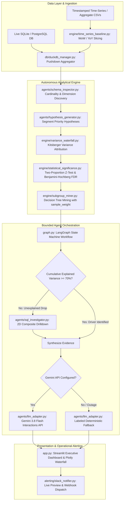

# Autonomous Metric Root Cause Analysis (RCA) & Variance Copilot

[](https://auto-rca.streamlit.app/)
[](https://www.python.org/downloads/)
[](tests/)
[](pyproject.toml)
[](pyproject.toml)
[](#-core-architecture--separation-of-concerns)
[](LICENSE)

An enterprise-grade, deterministic-first autonomous copilot designed to diagnose metric drops, attribute multi-dimensional variance, and synthesize executive-ready incident narratives.

> 🌐 **Live Web Application:** Experience the copilot instantly in your browser at [**auto-rca.streamlit.app**](https://auto-rca.streamlit.app/) *(no local installation or API key required)*.

---

## 💡 Core Philosophy: Separation of Compute & Reasoning

Standard "Chat with Data" or LLM-driven analytics bots fail in enterprise environments because:
1. **LLMs cannot do arithmetic reliably**: They hallucinate metric deltas, attribution sums, and conversion percentages.
2. **Unguarded Text-to-SQL introduces critical security & load risks**: Vulnerable to SQL injection, unbounded table scans, and database connection exhaustion.
3. **Statistical False Positives**: Naive prompts often flag a segment with 3 visits and 0 conversions as a "primary root cause."

**Autonomous Metric RCA Copilot** is built on a foundational principle: **Strict separation of compute and reasoning.**
* **Deterministic Compute**: All variance attribution, SQL pushdown, Benjamini-Hochberg false discovery rate control, and decision tree mining run strictly through deterministic analytical engines (DuckDB, NumPy, SciPy, Scikit-learn).
* **Bounded Reasoning**: LLMs (Gemini 3.8 Flash) are strictly restricted to synthesizing executive narratives and prioritized action items from precomputed, statistically validated evidence. The LLM is never permitted to calculate math.

---

## 🎯 Executive Summary & The Problem

When a core business metric (such as e-commerce checkout conversion rate) drops by **3.4% Week-over-Week**, executives and product teams need immediate, mathematically grounded answers:
* *Did user propensity drop within specific segments?* (**Rate Effect**)
* *Did traffic mix shift toward historically lower-converting channels, such as paid mobile campaigns?* (**Mix Effect / Simpson's Paradox**)
* *Is the drop statistically significant, or simply random sample noise in low-volume segments?* (**False Discovery Rate**)

Autonomous Metric RCA Copilot decomposes the drop, checks statistical significance across all hypotheses, performs agentic cross-dimensional drilldowns when single dimensions are insufficient, and delivers clear C-suite diagnostic narratives in seconds.

---

## 🏗️ Core Architecture & Separation of Concerns



---

## ✨ Key Capabilities

### 1. Deterministic Kitsberger Variance Decomposition
Decomposes aggregate conversion rate changes ($\Delta R = R_{\text{current}} - R_{\text{baseline}}$) into three mutually exclusive, mathematically reconciled components across every dimension:
* **Rate Effect ($W_b \times \Delta R$)**: Measures conversion rate changes within segments, holding baseline traffic volume constant.
* **Mix Effect ($R_b \times \Delta W$)**: Quantifies metric movement driven purely by traffic shifting toward higher- or lower-performing segments (**Simpson's Paradox**).
* **Interaction Effect ($\Delta R \times \Delta W$)**: Captures the joint dynamic of simultaneous rate and volume shifts.
* **Mathematical Invariant Contract**: $\text{Rate Effect} + \text{Mix Effect} + \text{Interaction Effect} \equiv \text{Total Contribution}$.

### 2. Statistical Significance & Benjamini-Hochberg FDR Control
To prevent false alarms and hallucinated drivers on sparse or volatile data:
* **Two-Tailed Pooled Two-Proportion $Z$-Test**: Calculates pooled standard errors and raw $p$-values for every segment's rate deviation.
* **Benjamini-Hochberg False Discovery Rate (FDR)**: Adjusts critical values across multi-hypothesis segment spaces ($\alpha = 0.05$) to control the expected proportion of false discoveries.
* **Confidence Tiers**: Annotates findings as `🟢 High Confidence` ($p \le 0.01$), `🟡 Moderate Confidence` ($p \le 0.05$), or `⚪ Statistical Noise` ($p > 0.05$).

### 3. Scalable Decision-Tree Subgroup Mining
* Mines high-impact multi-feature bottlenecks (e.g., `device = 'iOS' AND channel = 'Affiliate'`).
* **Algorithmic Scaling**: Uses Scikit-learn's `DecisionTreeClassifier` with native `sample_weight` over segment matrices.
* Memory complexity scales with unique segment combinations $O(K)$, completely avoiding row-expansion $O(N_{\text{visits}})$ to prevent out-of-memory errors on massive event streams.

### 4. Agentic 2D Cross-Dimensional Drilldown
* Evaluates the **Cumulative Explained Variance Ratio (CEVR)** from statistically significant 1D findings.
* If significant 1D findings explain less than **70%** of the total metric change and $\ge 2$ dimensions exist, LangGraph autonomously triggers a 2D composite pass (`channel x region`).
* The drilldown executes within a strictly bounded loop (capped at 1 pass) using read-only in-memory analytical frames.

### 5. Direct Database Pushdown & Guarded OLAP
* Powered by **DuckDB** for ultra-fast columnar analytical queries.
* **Direct Database Pushdown**: Attaches live **SQLite** and **PostgreSQL** databases as read-only catalogs via DuckDB `ATTACH`. Only aggregated grouped rows are returned over the wire; raw tables are never loaded into memory.
* **Strict SQL Guardrails**: AST and regex sanitization strictly blocks mutating statements (`DROP`, `DELETE`, `INSERT`, `UPDATE`, `ALTER`, `TRUNCATE`, `ATTACH`), multiline statements, comments, and unbounded joins.

```python
from db.duckdb_manager import DuckDBManager

with DuckDBManager() as manager:
    # Safely attach host database in read-only mode
    manager.attach_database("sqlite", "metrics.sqlite")
    
    # Pushdown aggregation executes entirely within the database engine
    aggregates = manager.query_aggregated_metric(
        "remote_db.clicks",
        dimensions=["channel", "device"],
        numerator="conversions",
        denominator="visits",
        where_clause="event_date >= '2026-01-01'",
    )
```

### 6. Resilient Hybrid LLM Architecture
* Powered by **Gemini 3.8 Flash** via the Google GenAI SDK.
* **Evidence-Only Prompting**: The LLM prompt is strictly supplied with precalculated statistical findings, effects, and subgroup rules. The LLM never computes math.
* **Zero-Downtime Deterministic Fallback**: If `GEMINI_API_KEY` is omitted or if provider quota/rate limits/timeouts occur, the engine returns a labeled deterministic narrative.
* Safe error classification (`CONFIGURATION`, `TIMEOUT`, `AUTHENTICATION`, `QUOTA`, `NETWORK`, `PROVIDER`) without leaking credentials or raw stack traces.

### 7. Interactive Executive UI & Operational Alerting
* **Streamlit Dashboard**: Dynamic comparison window preview, Plotly Kitsberger Waterfall chart, FDR confidence badges, and decision-tree rule inspector.
* **Direct Database Drawer**: Connects to SQLite or PostgreSQL in read-only mode, introspecting tables and columns with pushdown aggregation.
* **Slack Webhook Dispatcher**: Generates an executive markdown alert card with confidence badges and diagnostic next steps, ready for instant webhook dispatch.

---

## 📐 Mathematical Formulations

### 1. Kitsberger Variance Decomposition
For a given dimension containing segments $s \in S$:
* Baseline segment rate $r_b = k_b / n_b$, weight $w_b = n_b / N_b$
* Current segment rate $r_c = k_c / n_c$, weight $w_c = n_c / N_c$

$$\Delta R = \sum_{s \in S} \left( \underbrace{w_b \cdot (r_c - r_b)}_{\text{Rate Effect}} + \underbrace{r_b \cdot (w_c - w_b)}_{\text{Mix Effect}} + \underbrace{(r_c - r_b) \cdot (w_c - w_b)}_{\text{Interaction Effect}} \right)$$

### 2. Pooled Two-Proportion $Z$-Test
For segment baseline successes/trials $(k_b, n_b)$ and current $(k_c, n_c)$:

$$p_{\text{pool}} = \frac{k_b + k_c}{n_b + n_c}, \quad SE = \sqrt{p_{\text{pool}}(1 - p_{\text{pool}})\left(\frac{1}{n_b} + \frac{1}{n_c}\right)}$$

$$z = \frac{(k_c / n_c) - (k_b / n_b)}{SE}, \quad p = 2 \cdot \left(1 - \Phi(|z|)\right)$$

### 3. Benjamini-Hochberg False Discovery Rate (FDR)
Given $M$ sorted segment $p$-values $p_{(1)} \le p_{(2)} \le \dots \le p_{(M)}$, find the largest rank $k^*$ such that:

$$p_{(k^*)} \le \frac{k^*}{M} \cdot \alpha \quad (\alpha = 0.05)$$

All segment hypotheses with rank $k \le k^*$ are classified as statistically significant with false discovery rate bounded at $\alpha$.

---

## 🚀 Quickstart Guide

### Option 1: Live Demo (No Setup Needed)
Access the live deployed copilot at [**https://auto-rca.streamlit.app/**](https://auto-rca.streamlit.app/).

---

### Option 2: Local Installation

#### 1. Clone & Set Up Virtual Environment

```bash
# Clone the repository
git clone https://github.com/your-username/Autonomous-Metric-Root-Cause-Analysis-RCA-Variance-Copilot.git
cd Autonomous-Metric-Root-Cause-Analysis-RCA-Variance-Copilot

# Create and activate virtual environment
python -m venv .venv

# Windows
.venv\Scripts\activate
# macOS/Linux
source .venv/bin/activate

# Install core dependencies
pip install -r requirements.txt
```

#### 2. Optional: Enable Gemini-Powered Executive Narratives

To enable generative C-suite narratives and recommendations, configure your `.env` file:

```env
GEMINI_API_KEY=your_actual_gemini_api_key_here
GEMINI_MODEL=gemini-flash-latest
GEMINI_TIMEOUT_MS=120000
SLACK_WEBHOOK_URL=https://hooks.slack.com/services/... # Optional
```

Verify your Gemini integration using the fail-fast smoke test:

```bash
python scripts/verify_gemini.py
```

*(Note: The application runs with 100% functionality even without an API key by automatically activating the deterministic fallback synthesizer).*

#### 3. Run the Streamlit Copilot Dashboard

```bash
streamlit run src/app.py
```

---

## 📊 Dashboard Modes & Data Ingestion

The copilot supports four flexible data ingestion modes:

| Ingestion Mode | Input Format | Use Case |
| :--- | :--- | :--- |
| **Preloaded Aggregate Benchmark** | Built-in e-commerce benchmark | Instant exploration of rate/mix effects across device, browser, and region. |
| **Time-Series (WoW / YoY Slicing)** | Timestamped event stream | Automatic slicing into adjacent comparison windows (e.g., Week-over-Week). |
| **Custom CSV Upload** | Time-series CSV or dual baseline/current CSVs | Analyze your own business data by uploading raw event logs or pre-aggregated tables. |
| **Direct Database (SQLite / Postgres)** | Live database connection string | Zero-copy DuckDB pushdown aggregation directly on remote tables without loading raw rows. |

---

## 🧪 Quality & Engineering Standards

The project adheres to strict production software engineering principles:

```bash
# Run hermetic test suite (66 tests, 100% hermetic, < 25s execution)
pytest

# Enforce strict static typing (0 issues across 34 source files)
mypy src tests

# Fast static analysis and linting
ruff check src tests
```

### Engineering Guarantees
* **Hermetic Testing**: Unit and integration tests never make outbound network calls; all external APIs are mocked or verified via deterministic fallback seams.
* **Strict Static Typing**: `mypy --strict` compliance across 100% of the codebase with explicit package exports and Pydantic v2 runtime contracts.
* **SQL Injection Immunity**: Regex and AST validation forbids mutating keywords, comments, and multi-statements on all database operations.
* **Zero Scaffolding / Dead Code**: Verified by automated repository structure regression tests ([`test_package_layout.py`](file:///n:/projects/Autonomous%20Metric%20Root%20Cause%20Analysis%20%28RCA%29%20&%20Variance%20Copilot/Autonomous-Metric-Root-Cause-Analysis-RCA-Variance-Copilot/tests/test_package_layout.py)).

---

## 📁 Repository Structure

```
.
├── src/
│   ├── agents/                     # LangGraph nodes and contracts
│   │   ├── hypothesis_generator.py # Dimension-level hypothesis generator
│   │   ├── llm_adapter.py          # Gemini API client & deterministic fallback
│   │   ├── narrative_synthesizer.py# Executive narrative orchestrator
│   │   ├── schema_inspector.py     # DuckDB schema & cardinality profiler
│   │   ├── sql_investigator.py     # Attribution engine with significance filters
│   │   └── state.py                # Strict Pydantic v2 RCAState models
│   ├── alerting/
│   │   └── slack_notifier.py       # Slack incoming webhook dispatcher & preview
│   ├── db/
│   │   └── duckdb_manager.py       # Read-only DuckDB wrapper with query guardrails
│   ├── engine/                     # Pure analytical and statistical core
│   │   ├── statistical_significance.py # Two-proportion z-test & Benjamini-Hochberg FDR
│   │   ├── subgroup_miner.py       # Weighted decision tree subgroup discovery
│   │   ├── time_series_baseline.py # WoW / YoY calendar window slicers
│   │   └── variance_waterfall.py   # Kitsberger rate/mix/interaction decomposition
│   ├── app.py                      # Streamlit executive dashboard & Plotly charts
│   └── graph.py                    # LangGraph StateGraph workflow definition
├── tests/                          # 66 hermetic unit and integration tests
├── data/                           # Reproducible synthetic dataset generators
├── docs/                           # Architecture specs & enterprise roadmaps
├── scripts/                        # Standalone provider smoke tests
├── pyproject.toml                  # Poetry package configuration & tool settings
└── requirements.txt                # Production dependencies
```

---

## 📄 License

Distributed under the MIT License. See [LICENSE](file:///n:/projects/Autonomous%20Metric%20Root%20Cause%20Analysis%20%28RCA%29%20&%20Variance%20Copilot/Autonomous-Metric-Root-Cause-Analysis-RCA-Variance-Copilot/LICENSE) for details.
