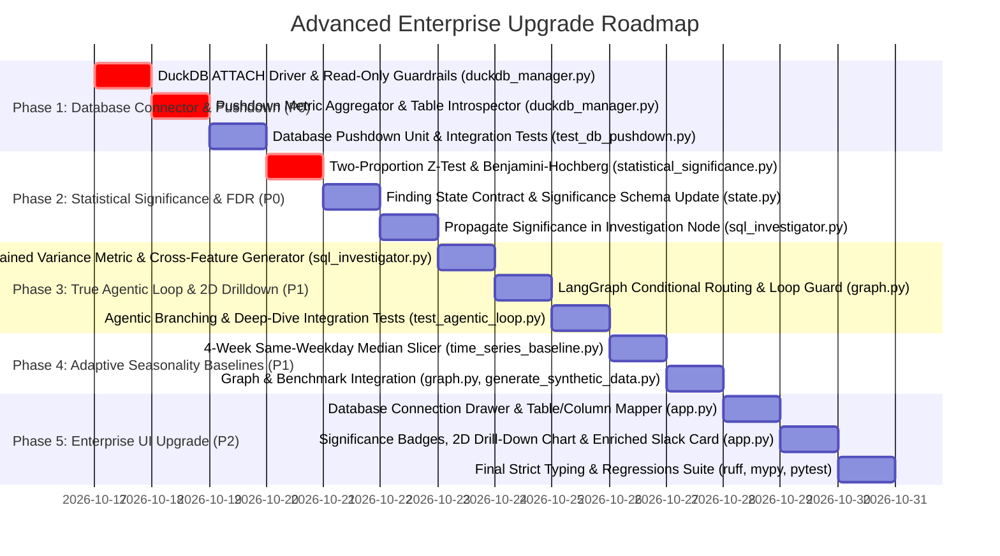
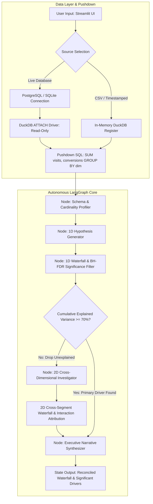

# Enterprise RCA Copilot - Advanced Production Upgrade Plan

This implementation plan details the technical architecture, mathematical formulations, and step-by-step changes required to elevate the **Autonomous Metric Root Cause Analysis & Variance Copilot** from a local analytical tool into a venture-backed, enterprise-grade root cause analysis system.

---

## 🎯 Architecture & Upgrade Roadmap





---

## 📂 Phase 1: Direct Database Connector & Pushdown Engine (P0)

### Goal
Eliminate CSV file size limitations and PII compliance risks by connecting directly to live databases (PostgreSQL and SQLite) through DuckDB zero-copy `ATTACH`, executing analytical aggregations directly on the host database.

### Step 1.1: DuckDB `ATTACH` Engine with Driver-Level Read-Only Guardrails
* **Target File**: [`src/db/duckdb_manager.py`](file:///n:/projects/Autonomous%20Metric%20Root%20Cause%20Analysis%20%28RCA%29%20&%20Variance%20Copilot/Autonomous-Metric-Root-Cause-Analysis-RCA-Variance-Copilot/src/db/duckdb_manager.py)
* **Changes**:
  1. Add `attach_database(db_type: str, connection_string: str, alias: str = "remote_db") -> None`:
     - **SQLite**: Execute `ATTACH '<path>' AS remote_db (TYPE SQLITE, READ_ONLY);`.
     - **PostgreSQL**: Execute `INSTALL postgres; LOAD postgres; ATTACH '<conn_string>' AS remote_db (TYPE POSTGRES, READ_ONLY);`.
  2. Enforce strict connection sanitization:
     - Disallow multiple statements or illegal characters in aliases.
     - Never log, print, or expose connection passwords in error messages or state traces.
  3. Add `list_tables(alias: str = "remote_db") -> list[str]` to introspect table names without loading data.
  4. Add `detach_database(alias: str = "remote_db") -> None` for clean teardown in `__exit__`.

### Step 1.2: Server-Side Pushdown Metric Aggregator
* **Target File**: [`src/db/duckdb_manager.py`](file:///n:/projects/Autonomous%20Metric%20Root%20Cause%20Analysis%20%28RCA%29%20&%20Variance%20Copilot/Autonomous-Metric-Root-Cause-Analysis-RCA-Variance-Copilot/src/db/duckdb_manager.py)
* **Changes**:
  1. Add `query_aggregated_metric(table: str, dimensions: list[str], numerator: str, denominator: str, where_clause: str | None = None) -> pd.DataFrame`.
  2. Automatically generate the group-by SQL query:
     ```sql
     SELECT
         {dimension_cols},
         SUM({numerator}) AS {numerator},
         SUM({denominator}) AS {denominator}
     FROM {table}
     {where_filter}
     GROUP BY {dimension_cols}
     ```
  3. Validate all identifiers with `^[A-Za-z_][A-Za-z0-9_.]*$` to prevent SQL injection.
  4. Ensure only aggregated rows (typically $< 100$ rows) are returned across the wire into memory.

### Step 1.3: Isolated Database Pushdown Test Suite
* **Target File**: New file `tests/db/test_db_pushdown.py`
* **Changes**:
  1. Use Python's built-in `sqlite3` to generate a temporary on-disk SQLite database containing 50,000 raw clickstream rows.
  2. Verify that `DuckDBManager.attach_database(db_type="sqlite", ...)` attaches in read-only mode and that write operations (`INSERT`, `UPDATE`, `DROP`) are strictly blocked.
  3. Verify `query_aggregated_metric` executes pushdown aggregation and returns the exact mathematical sums in $< 10\text{ms}$.

---

## 📂 Phase 2: Statistical Significance & Multiple Comparison Correction (P0)

### Goal
Prevent false positives and statistical noise (e.g. flagging a segment with 3 visits and 0 conversions as the "primary root cause"). Apply two-proportion $z$-tests with the **Benjamini-Hochberg (FDR)** procedure.

### Step 2.1: Mathematical Formulation & Module Implementation
* **Target File**: New file [`src/engine/statistical_significance.py`](file:///n:/projects/Autonomous%20Metric%20Root%20Cause%20Analysis%20%28RCA%29%20&%20Variance%20Copilot/Autonomous-Metric-Root-Cause-Analysis-RCA-Variance-Copilot/src/engine/statistical_significance.py)
* **Mathematical Specification**:
  1. **Pooled Rate & Standard Error**:
     For a segment with baseline $(k_b, n_b)$ and current $(k_c, n_c)$:
     $$p_{\text{pool}} = \frac{k_b + k_c}{n_b + n_c}$$
     $$SE = \sqrt{p_{\text{pool}} (1 - p_{\text{pool}}) \left( \frac{1}{n_b} + \frac{1}{n_c} \right)}$$
     If $n_b = 0$, $n_c = 0$, or $p_{\text{pool}} \in \{0, 1\}$, set $SE = 0, z = 0, p = 1.0$.
  2. **Two-Tailed $Z$-Statistic & Raw $P$-Value**:
     $$z = \frac{(k_c / n_c) - (k_b / n_b)}{SE}$$
     $$p = 2 \cdot \left( 1 - \Phi(|z|) \right) \quad \text{using } \texttt{scipy.stats.norm.sf}$$
  3. **Benjamini-Hochberg False Discovery Rate (FDR) Procedure**:
     Given $M$ segment hypotheses with raw $p$-values $p_1, \dots, p_M$:
     - Sort $p$-values in ascending order: $p_{(1)} \le p_{(2)} \le \dots \le p_{(M)}$.
     - Calculate adjusted critical values: $q_k = \frac{k}{M} \cdot \alpha$, where $\alpha = 0.05$.
     - Find the largest index $k^*$ such that $p_{(k^*)} \le q_{k^*}$.
     - All segments with rank $k \le k^*$ are declared **statistically significant** (`is_statistically_significant = True`).
     - Assign `confidence_tier`:
       - `high`: $p_{(k)} \le 0.01$ and $k \le k^*$
       - `moderate`: $p_{(k)} \le 0.05$ and $k \le k^*$
       - `noise`: $p_{(k)} > 0.05$ or $k > k^*$

### Step 2.2: Schema & State Contract Updates
* **Target File**: [`src/agents/state.py`](file:///n:/projects/Autonomous%20Metric%20Root%20Cause%20Analysis%20%28RCA%29%20&%20Variance%20Copilot/Autonomous-Metric-Root-Cause-Analysis-RCA-Variance-Copilot/src/agents/state.py)
* **Changes**:
  ```python
  class Finding(BaseModel):
      model_config = ConfigDict(extra="forbid")
      dimension: str
      segment: str
      contribution: float
      rate_effect: float = 0.0
      mix_effect: float = 0.0
      interaction_effect: float = 0.0
      p_value: float = 1.0
      is_statistically_significant: bool = False
      confidence_tier: Literal["high", "moderate", "noise"] = "noise"
      evidence: str
  ```

### Step 2.3: Integration in SQL Investigator Node
* **Target File**: [`src/agents/sql_investigator.py`](file:///n:/projects/Autonomous%20Metric%20Root%20Cause%20Analysis%20%28RCA%29%20&%20Variance%20Copilot/Autonomous-Metric-Root-Cause-Analysis-RCA-Variance-Copilot/src/agents/sql_investigator.py)
* **Changes**:
  1. Pass the full list of dimensional findings through `evaluate_findings_significance(findings, alpha=0.05)`.
  2. Embed the statistical confidence and adjusted $p$-value into the `Finding.evidence` string.

---

## 📂 Phase 3: True Agentic Loop & 2D Cross-Dimensional Drilldown (P1)

### Goal
Enable the agent to autonomously detect when 1-dimensional cuts fail to explain a metric drop (e.g. drop is concentrated in `device='mobile' AND region='APAC'`) and loop back to compute 2-way cross-dimensional waterfall attribution.

### Step 3.1: Cumulative Explained Variance Ratio (CEVR) Gate
* **Target File**: [`src/agents/state.py`](file:///n:/projects/Autonomous%20Metric%20Root%20Cause%20Analysis%20%28RCA%29%20&%20Variance%20Copilot/Autonomous-Metric-Root-Cause-Analysis-RCA-Variance-Copilot/src/agents/state.py) and [`src/agents/sql_investigator.py`](file:///n:/projects/Autonomous%20Metric%20Root%20Cause%20Analysis%20%28RCA%29%20&%20Variance%20Copilot/Autonomous-Metric-Root-Cause-Analysis-RCA-Variance-Copilot/src/agents/sql_investigator.py)
* **Logic**:
  1. Add `requires_deep_dive: bool = False`, `loop_count: int = 0`, and `deep_dive_dimension: str | None = None` to `RCAState`.
  2. Compute total metric change: $\Delta R = R_{\text{current}} - R_{\text{baseline}}$.
  3. Calculate explained coverage from statistically significant 1D findings:
     $$\text{Coverage} = \frac{\sum_{f \in \text{Significant Top 1D Findings}} |f.\text{contribution}|}{|\Delta R|}$$
  4. If $\text{Coverage} < 0.70$ and $\text{dimensions} \ge 2$:
     Set `state.requires_deep_dive = True` and select the top 2 candidate dimensions for intersection.

### Step 3.2: 2D Cross-Segment Generator Node
* **Target File**: [`src/agents/sql_investigator.py`](file:///n:/projects/Autonomous%20Metric%20Root%20Cause%20Analysis%20%28RCA%29%20&%20Variance%20Copilot/Autonomous-Metric-Root-Cause-Analysis-RCA-Variance-Copilot/src/agents/sql_investigator.py)
* **Logic**:
  1. Function: `investigate_cross_dimensions(state: RCAState, manager: DuckDBManager) -> RCAState`.
  2. In DuckDB, synthesize cross-dimensional views:
     ```sql
     CREATE TEMP VIEW current_metrics_2d AS
     SELECT
         CONCAT({dim1}, ' x ', {dim2}) AS {dim1}_{dim2},
         {numerator},
         {denominator}
     FROM current_metrics;
     ```
  3. Run `dimension_waterfall` and FDR statistical testing over the composite cross-feature `{dim1}_{dim2}`.
  4. Append discovered 2D drivers to `state.findings` tagged with `dimension=f"{dim1} x {dim2}"`.
  5. Increment `state.loop_count += 1` and reset `state.requires_deep_dive = False`.

### Step 3.3: LangGraph Conditional Edge Routing
* **Target File**: [`src/graph.py`](file:///n:/projects/Autonomous%20Metric%20Root%20Cause%20Analysis%20%28RCA%29%20&%20Variance%20Copilot/Autonomous-Metric-Root-Cause-Analysis-RCA-Variance-Copilot/src/graph.py)
* **Workflow Construction**:
  ```python
  def routing_condition(state_dict: GraphState) -> str:
      if state_dict.get("requires_deep_dive", False) and state_dict.get("loop_count", 0) < 1:
          return "cross_dimensional_investigation"
      return "narrative"

  workflow.add_node("investigation", investigation_node)
  workflow.add_node("cross_dimensional_investigation", cross_investigation_node)
  workflow.add_conditional_edges("investigation", routing_condition, {
      "cross_dimensional_investigation": "cross_dimensional_investigation",
      "narrative": "narrative",
  })
  workflow.add_edge("cross_dimensional_investigation", "narrative")
  ```

---

## 📂 Phase 4: Adaptive Seasonality Baseline (4-Week Same-Weekday Median) (P1)

### Goal
Eliminate false alarms caused by predictable day-of-week seasonality (e.g. weekends having naturally lower conversion rates than weekdays) by comparing against a multi-week, calendar-matched baseline.

### Step 4.1: Same-Weekday Historical Window Slicing
* **Target File**: [`src/engine/time_series_baseline.py`](file:///n:/projects/Autonomous%20Metric%20Root%20Cause%20Analysis%20%28RCA%29%20&%20Variance%20Copilot/Autonomous-Metric-Root-Cause-Analysis-RCA-Variance-Copilot/src/engine/time_series_baseline.py)
* **Changes**:
  1. Add `slice_seasonal_baseline(df: pd.DataFrame, timestamp_col: str = "timestamp", n_weeks: int = 4, test_days: int = 7) -> tuple[pd.DataFrame, pd.DataFrame]`:
     - Test Window: Latest `test_days` (e.g. last 7 days).
     - For each day in the test window, locate the same day of the week in each of the preceding `n_weeks` (e.g. prior 4 Mondays for a Monday).
     - For each dimensional segment and matching weekday, compute the **median** visits and **median** conversions across the 4 historical occurrences.
     - Return the median-aggregated frame as `baseline` and the observed window as `current`.
  2. Add `mode="seasonal"` support to `run_timeseries_analysis()`.

### Step 4.2: Benchmark Dataset Support
* **Target File**: [`data/generate_synthetic_data.py`](file:///n:/projects/Autonomous%20Metric%20Root%20Cause%20Analysis%20%28RCA%29%20&%20Variance%20Copilot/Autonomous-Metric-Root-Cause-Analysis-RCA-Variance-Copilot/data/generate_synthetic_data.py)
* Update `generate_timeseries_dataset(days=60)` to allow generating 60-day time-series benchmarks with embedded weekly cyclicality.

---

## 📂 Phase 5: Streamlit Enterprise Dashboard Upgrade (P2)

### Goal
Expose the database connection drawer, statistical confidence badges, and 2D drilldown visualizer in the UI.

### Step 5.1: Live Database Connection Drawer
* **Target File**: [`src/app.py`](file:///n:/projects/Autonomous%20Metric%20Root%20Cause%20Analysis%20%28RCA%29%20&%20Variance%20Copilot/Autonomous-Metric-Root-Cause-Analysis-RCA-Variance-Copilot/src/app.py)
* **Sidebar Controls**:
  - Add data mode option: `"Direct Database (SQLite / Postgres)"`.
  - Input fields: Database Type (`SQLite`, `PostgreSQL`), Connection Path / URI.
  - "Test Connection & Introspect" button.
  - Dropdowns for: Target Table, Timestamp Column, Numerator Column, Denominator Column, Dimensions Multi-select.

### Step 5.2: Statistical Significance & FDR Confidence Badges
* In the Dimensional Contributions table, format rows with visual indicators:
  - 🟢 **High Confidence**: $p \le 0.01$ (FDR controlled)
  - 🟡 **Moderate Confidence**: $p \le 0.05$ (FDR controlled)
  - ⚪ **Statistical Noise**: $p > 0.05$ (Filtered out or marked inconclusive)

### Step 5.3: 2D Deep-Dive Visualizer & Enriched Slack Card
* **Target File**: [`src/app.py`](file:///n:/projects/Autonomous%20Metric%20Root%20Cause%20Analysis%20%28RCA%29%20&%20Variance%20Copilot/Autonomous-Metric-Root-Cause-Analysis-RCA-Variance-Copilot/src/app.py) & [`src/alerting/slack_notifier.py`](file:///n:/projects/Autonomous%20Metric%20Root%20Cause%20Analysis%20%28RCA%29%20&%20Variance%20Copilot/Autonomous-Metric-Root-Cause-Analysis-RCA-Variance-Copilot/src/alerting/slack_notifier.py)
* If the agent performed a 2D deep dive, render a dedicated **Cross-Dimensional Interaction Waterfall**.
* Update Slack alert markdown to include the confidence tier and whether an autonomous deep dive was triggered.

---

## 📋 File Modification Matrix

| Order | Action | File Path | Scope of Modification |
| :---: | :---: | :--- | :--- |
| **1** | Create | `src/engine/statistical_significance.py` | Two-proportion $z$-test and Benjamini-Hochberg FDR correction. |
| **2** | Create | `tests/engine/test_statistical_significance.py` | Unit tests for statistical tests, $p$-values, and edge cases. |
| **3** | Edit | `src/agents/state.py` | Add $p$-value, statistical significance, and agentic loop control fields. |
| **4** | Edit | `src/db/duckdb_manager.py` | Implement `attach_database`, `list_tables`, and pushdown aggregations. |
| **5** | Create | `tests/db/test_db_pushdown.py` | Test SQLite pushdown and read-only enforcement. |
| **6** | Edit | `src/agents/sql_investigator.py` | Integrate FDR significance filter and 2D cross-segment investigator. |
| **7** | Edit | `src/engine/time_series_baseline.py` | Add `slice_seasonal_baseline` (4-week same-weekday median). |
| **8** | Create | `tests/engine/test_seasonal_baseline.py` | Test weekday-matched baseline logic against synthetic data. |
| **9** | Edit | `src/graph.py` | Implement LangGraph conditional edge for autonomous 2D loop. |
| **10** | Create | `tests/test_agentic_loop.py` | Verify graph loops autonomously when 1D explained variance $< 70\%$. |
| **11** | Edit | `src/alerting/slack_notifier.py` | Include statistical confidence tier and deep dive indicator in alert. |
| **12** | Edit | `src/app.py` | Add database connector drawer, significance badges, and 2D charts. |
| **13** | Edit | `pyproject.toml` | Ensure package exports, dependencies, and testpaths are synchronized. |

---

## 🛡️ Verification & Acceptance Criteria

1. **Deterministic Test Execution Speed**:
   The full suite (now including SQLite pushdown, BH-FDR math, and LangGraph looping) completes in **$< 3.0$ seconds** with 0 failures.
2. **Pushdown Security & Bounded Memory**:
   Querying a 50,000-row SQLite database via `DuckDBManager.attach_database` returns $< 100$ aggregated rows; write queries trigger immediate `ValueError`.
3. **Statistical Noise Filtering**:
   Segments with small sample sizes ($N < 30$) or small deltas that fail Benjamini-Hochberg FDR ($\alpha = 0.05$) are marked `noise` and excluded from executive alert cards.
4. **Autonomous Agent Looping**:
   When synthetic data contains an anomaly concentrated in an interaction pair (e.g. `mobile` $\times$ `APAC`), the graph detects $<70\%$ 1D explained variance, autonomously triggers the `cross_dimensional_investigator` node, and reports the 2D driver.
5. **Static Analysis & Typing**:
   Zero `ruff` lint errors and zero `mypy --strict` type issues across `src/` and `tests/`.
